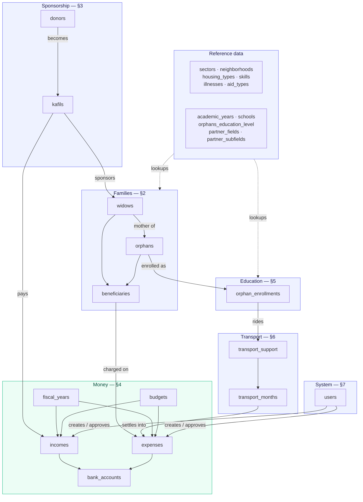
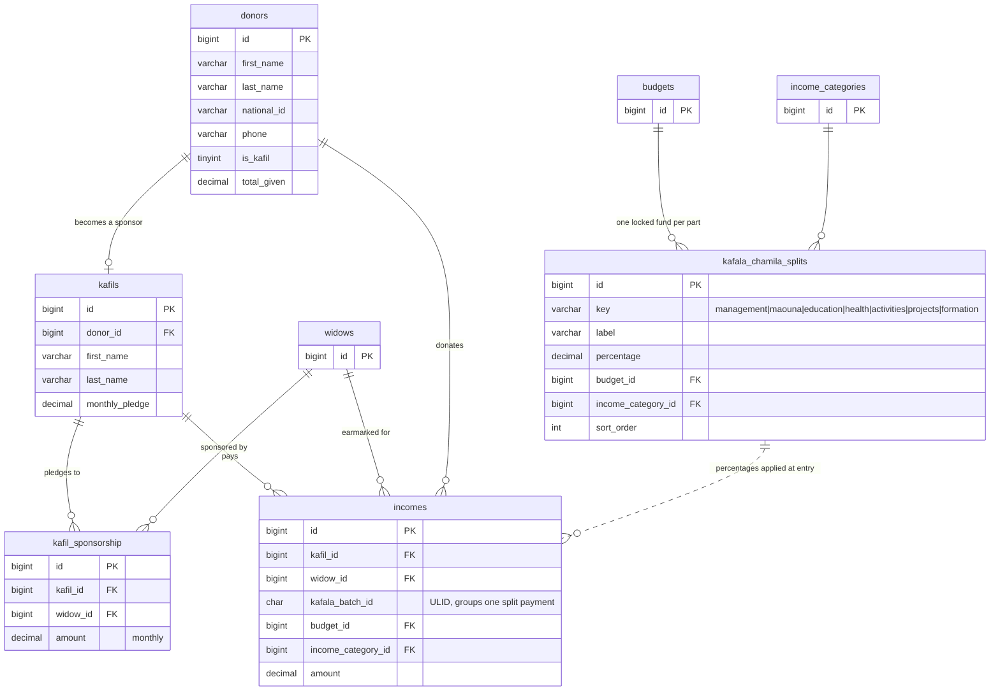
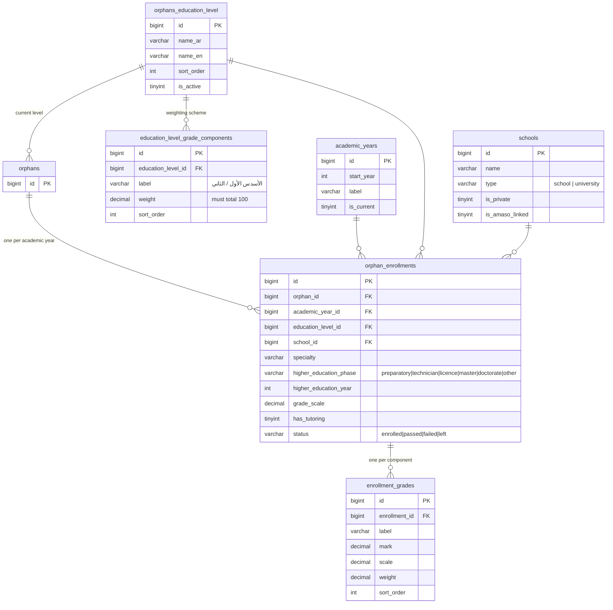
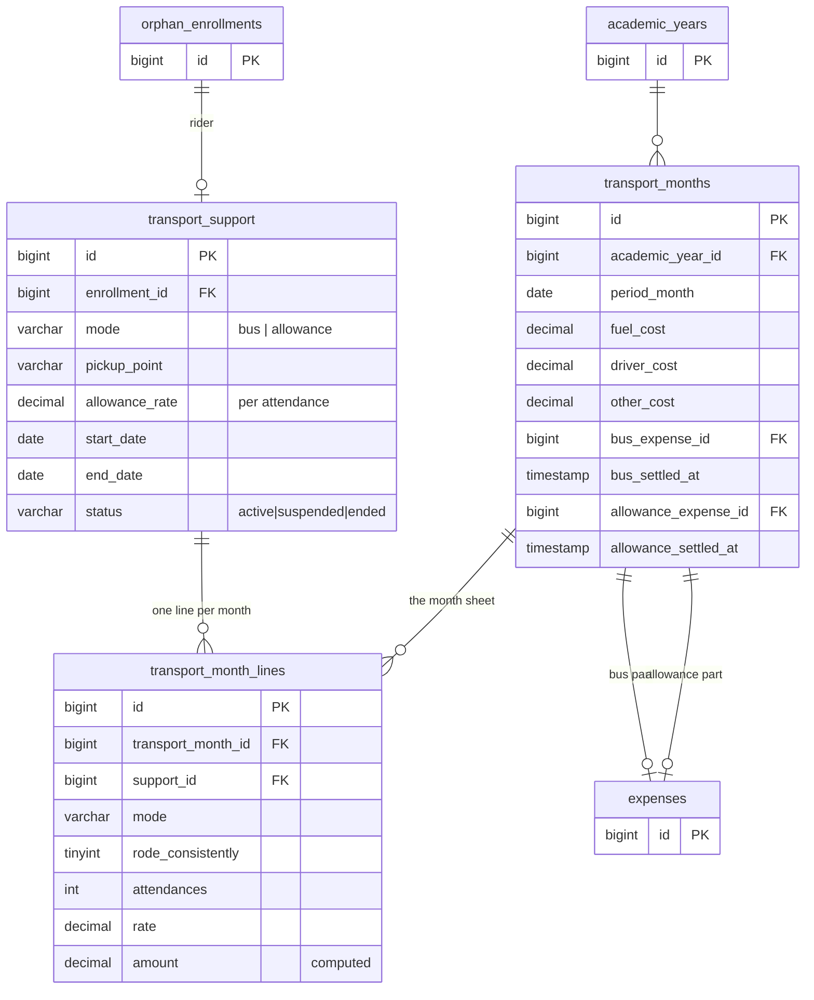
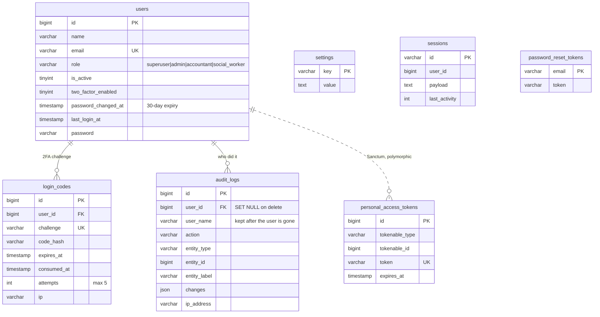

# Data model

**63 tables and one view.** Drawn from the schema itself
(`amaso.sql`, generated from a migrated database) rather than from the
models, so what is here is what MariaDB actually enforces.

Every table appears exactly once across sections 2–7. One diagram of all 63
would be unreadable, so they are split by area; the arrows that cross
between areas are drawn in the section that owns the child table, and the
map in §1 shows how the areas join up.

Naming in these diagrams follows the database, not the Eloquent models —
`orphans_education_level` really is singular, `transport_support` really
has no plural, and `kafil_sponsorship` really is the sponsorship table.

---

## 1. The map



The thing to take from this: **everything hangs off `widows`.** A family is
the unit of record. Children, sponsorship, education, transport and most
spending all trace back to one row in that table.

---

## 2. Families and the social file

The beneficiary core, plus the *dossier social* — what the association
knows about a family's circumstances.

```mermaid
erDiagram
    widows {
        bigint id PK
        varchar first_name
        varchar last_name
        varchar national_id
        varchar neighborhood "free text, NOT a FK"
        date admission_date
        date birth_date
        date husband_death_date
        date idda_end_date
        tinyint is_idda_case
        varchar marital_status
        tinyint disability_flag
        date leaving_date
        timestamp deleted_at "soft delete"
    }
    orphans {
        bigint id PK
        bigint widow_id FK
        bigint education_level_id FK
        varchar first_name
        varchar gender
        date birth_date
        varchar cin
        tinyint is_schooled
        tinyint is_working
        varchar masar_code
        timestamp deleted_at "soft delete"
    }
    beneficiaries {
        bigint id PK
        varchar type "widow | orphan"
        bigint widow_id FK
        bigint orphan_id FK
    }
    beneficiary_groups {
        bigint id PK
        varchar label
    }
    beneficiary_group_members {
        bigint group_id FK
        bigint beneficiary_id FK
    }
    widow_phones {
        bigint id PK
        bigint widow_id FK
        varchar phone
        varchar label
    }
    widow_files {
        bigint id PK
        bigint widow_id FK
        varchar social_situation "single|widow|divorced|remarried"
        tinyint has_chronic_disease
        tinyint has_maouna
    }
    widow_social {
        bigint id PK
        bigint widow_id FK
        bigint housing_type_id FK
        varchar housing_status
        tinyint has_water
        tinyint has_electricity
        tinyint has_furniture
    }
    widow_social_income {
        bigint id PK
        bigint widow_id FK
        bigint income_category_id FK
        decimal amount
    }
    widow_social_expense {
        bigint id PK
        bigint widow_id FK
        bigint expense_category_id FK
        decimal amount
    }
    widow_maouna {
        bigint id PK
        bigint widow_id FK
        bigint partner_id FK
        decimal amount
        tinyint is_active
    }
    widow_aid {
        bigint id PK
        bigint widow_id FK
        bigint aid_type_id FK
        tinyint is_active
    }
    widow_skill {
        bigint id PK
        bigint widow_id FK
        bigint skill_id FK
    }
    widow_illness {
        bigint id PK
        bigint widow_id FK
        bigint illness_id FK
    }
    widow_income_categories {
        bigint id PK
        varchar name
    }
    widow_expense_categories {
        bigint id PK
        varchar name
    }
    housing_types {
        bigint id PK
        varchar label
    }
    skills {
        bigint id PK
        varchar label
    }
    illnesses {
        bigint id PK
        varchar label
        tinyint is_chronic
    }
    aid_types {
        bigint id PK
        varchar label
    }
    sectors {
        bigint id PK
        varchar label
    }
    neighborhoods {
        bigint id PK
        varchar label
        bigint sector_id FK
    }
    partners {
        bigint id PK
    }

    widows ||--o{ orphans : "mother of"
    widows ||--o| widow_files : "social file"
    widows ||--o| widow_social : "housing"
    widows ||--o{ widow_phones : "numbers"
    widows ||--o{ widow_social_income : "household income"
    widows ||--o{ widow_social_expense : "household expense"
    widows ||--o{ widow_maouna : "provision from partners"
    widows ||--o{ widow_aid : "aid received"
    widows ||--o{ widow_skill : ""
    widows ||--o{ widow_illness : ""
    widows ||--o| beneficiaries : "is a"
    orphans ||--o| beneficiaries : "is a"
    beneficiaries ||--o{ beneficiary_group_members : ""
    beneficiary_groups ||--o{ beneficiary_group_members : ""
    widow_income_categories ||--o{ widow_social_income : "classifies"
    widow_expense_categories ||--o{ widow_social_expense : "classifies"
    housing_types ||--o{ widow_social : ""
    skills ||--o{ widow_skill : ""
    illnesses ||--o{ widow_illness : ""
    aid_types ||--o{ widow_aid : ""
    sectors ||--o{ neighborhoods : "contains"
    partners ||--o{ widow_maouna : "provides it"
```



Three things the shapes are telling you:

- **`beneficiaries` is the join point for money.** A widow or an orphan can
  each have one row in it, and expenses are charged against *that* row —
  so one expense distribution can mix mothers and children.
- **`widows.neighborhood` is a `varchar(120)`, not a foreign key** to
  `neighborhoods`, despite that table existing and being used elsewhere.
  It is indexed and matched by string. Treat it as known debt.
- **Soft deletes on `widows` and `orphans` only.** A family that leaves
  keeps its history. Nothing else in the schema has `deleted_at`, so every
  other delete is permanent.

---

## 3. Sponsorship



`kafala_chamila_splits` is drawn with a **dashed** line to `incomes`
because there is no foreign key: the split rules are read at the moment of
entry, the percentages are applied, and the resulting rows carry only the
`budget_id` / `income_category_id` they produced plus a shared
`kafala_batch_id`. Change a percentage and nothing already recorded moves.

---

## 4. Money

The ledger. This is the area with the real constraints, and the one to
read most carefully before changing anything.

```mermaid
erDiagram
    fiscal_years {
        bigint id PK
        int year
        tinyint is_active
        decimal carryover_prev_year
        decimal carryover_next_year
    }
    budgets {
        bigint id PK
        varchar label
        tinyint is_default "exactly one"
        tinyint is_idda
    }
    income_categories {
        bigint id PK
        bigint parent_id FK "one level deep"
        varchar label
    }
    expense_categories {
        bigint id PK
        bigint parent_id FK "one level deep"
        varchar label
    }
    budget_income_category {
        bigint id PK
        bigint budget_id FK
        bigint category_id FK
    }
    budget_expense_category {
        bigint id PK
        bigint budget_id FK
        bigint category_id FK
    }
    incomes {
        bigint id PK
        bigint fiscal_year_id FK
        bigint budget_id FK
        bigint income_category_id FK
        bigint donor_id FK
        bigint kafil_id FK
        bigint widow_id FK
        bigint bank_account_id FK
        char kafala_batch_id
        date income_date
        decimal amount
        varchar payment_method
        varchar status "Draft | Approved"
        bigint created_by FK
        bigint approved_by FK
        timestamp transferred_at
    }
    expenses {
        bigint id PK
        bigint fiscal_year_id FK
        bigint budget_id FK
        bigint expense_category_id FK
        bigint partner_id FK
        bigint bank_account_id FK
        date expense_date
        decimal amount
        varchar payment_method
        tinyint unrelated_to_benef
        varchar status "Draft | Approved"
        bigint created_by FK
        bigint approved_by FK
    }
    expense_beneficiaries {
        bigint id PK
        bigint expense_id FK
        bigint beneficiary_id FK
        bigint group_id FK
        decimal amount "must sum to the expense"
    }
    bank_accounts {
        bigint id PK
        varchar label
        varchar bank_name
        decimal balance
        decimal opening_balance
    }
    bank_account_transactions {
        bigint id PK
        bigint bank_account_id FK
        varchar source_type "income|income_deposit|expense|transfer_out|transfer_in"
        bigint source_id "no FK - points at any of the above"
        decimal amount
        decimal balance_after
        bigint created_by FK
    }
    transfers {
        bigint id PK
        bigint fiscal_year_id FK
        bigint from_account_id FK
        bigint to_account_id FK
        decimal amount
        varchar status
        bigint created_by FK
        bigint approved_by FK
    }
    partners {
        bigint id PK
        varchar name
        bigint field_id FK
        bigint subfield_id FK
    }
    partner_fields {
        bigint id PK
        varchar label
    }
    partner_subfields {
        bigint id PK
        bigint field_id FK
        varchar label
    }
    beneficiaries {
        bigint id PK
    }
    beneficiary_groups {
        bigint id PK
    }
    users {
        bigint id PK
    }

    fiscal_years ||--o{ incomes : ""
    fiscal_years ||--o{ expenses : ""
    fiscal_years ||--o{ transfers : ""
    budgets ||--o{ incomes : "booked into"
    budgets ||--o{ expenses : "paid out of"
    income_categories ||--o{ incomes : "classifies"
    expense_categories ||--o{ expenses : "classifies"
    income_categories ||--o{ income_categories : "parent of"
    expense_categories ||--o{ expense_categories : "parent of"
    budgets ||--o{ budget_income_category : ""
    income_categories ||--o{ budget_income_category : ""
    budgets ||--o{ budget_expense_category : ""
    expense_categories ||--o{ budget_expense_category : ""
    expenses ||--o{ expense_beneficiaries : "distributed over"
    beneficiaries ||--o{ expense_beneficiaries : ""
    beneficiary_groups ||--o{ expense_beneficiaries : "or a whole group"
    bank_accounts ||--o{ incomes : "deposited to"
    bank_accounts ||--o{ expenses : "paid from"
    bank_accounts ||--o{ bank_account_transactions : "running balance"
    bank_accounts ||--o{ transfers : "from"
    bank_accounts ||--o{ transfers : "to"
    partners ||--o{ expenses : "paid to"
    partner_fields ||--o{ partners : ""
    partner_fields ||--o{ partner_subfields : ""
    partner_subfields ||--o{ partners : ""
    users ||--o{ incomes : "created / approved"
    users ||--o{ expenses : "created / approved"
    users ||--o{ transfers : "created / approved"
    users ||--o{ bank_account_transactions : "recorded by"
```



**`v_current_cash`** is the only view:

```sql
CREATE VIEW v_current_cash AS
  SELECT IFNULL(SUM(balance), 0.00) AS current_cash FROM bank_accounts
```

Invariants the diagram cannot draw, and that nothing in MariaDB enforces:

- `expense_beneficiaries.amount` must sum to `expenses.amount`. Held by
  `app/Services/`, in a transaction, under lock.
- `bank_account_transactions.balance_after` is a running balance, and
  `bank_accounts.balance` must agree with the last row.
  `php artisan amaso:finance-reconcile` checks this.
- `source_id` has **no foreign key** — it points at an income, an expense
  or a transfer depending on `source_type`. Deleting one of those does not
  cascade here. This is deliberate (one ledger over four sources) and it is
  the sharpest edge in the schema.
- Exactly one `budgets.is_default`. The seeder enforces it by resetting the
  flag on every other row.
- Categories nest **one level only** (`parent_id`), and id `999` in both
  category tables is the sentinel that records of a deleted category fall
  back to. Do not renumber.

---

## 5. Education



A level defines its weighting scheme once
(`education_level_grade_components`, defaulting to two semesters at 50 %),
and each enrollment gets one `enrollment_grades` row per component. The
year's result is the weighted sum — the weights are copied onto the grade
row, so re-weighting a level later does not silently restate past years.

---

## 6. School transport

Small, but it has a month-end settlement cycle, which is why it reaches
back into `expenses`.



**A month has two settlement links, not one**, and they are independent —
hence `bus_expense_id` *and* `allowance_expense_id`, each with its own
`settled_at`. That is where the `partial` status comes from. How each side
is computed is in [`GLOSSARY.md`](GLOSSARY.md#6-school-transport): the bus
pot is split pro rata by attendance, the allowance is rate × attendances.

Note that transport attaches to the **enrollment**, not to the orphan — a
child who changes school mid-year gets a new enrollment and a new support
row.

---

## 7. Accounts and Laravel plumbing



`audit_logs.user_name` is denormalised on purpose: the foreign key is
`ON DELETE SET NULL`, so the log survives the account being removed and
still says who acted.

`personal_access_tokens` is dashed for the same reason as the split rules
in §3 — Sanctum links through `tokenable_type` / `tokenable_id`, so there
is no foreign key and no cascade.

Six more tables are Laravel's own and carry no domain data:
`cache`, `cache_locks`, `jobs`, `job_batches`, `failed_jobs`, `migrations`.

---

## 8. What a schema diagram cannot show you

| | |
|---|---|
| **`widows.neighborhood` is text** | The `neighborhoods` table exists and is used elsewhere; this column is not joined to it. |
| **`bank_account_transactions.source_id` has no FK** | It points at an income, expense or transfer by `source_type`. No cascade, no referential integrity. |
| **`incomes.kafala_batch_id` has no FK** | A ULID grouping the rows of one split sponsorship payment. |
| **Approval is a `status` string** | `Draft` / `Approved` on incomes, expenses and transfers. The rules around the transition are in `app/Services/`, not in the schema. |
| **A widow in عدة is not a family yet** | `is_idda_case` changes what every count means. See [`GLOSSARY.md`](GLOSSARY.md#2-عدة-and-new-orphanhood). |
| **Soft deletes are on two tables only** | `widows` and `orphans`. Queries must exclude `deleted_at`; history must not. |
| **Money rules live in services** | Sums, balances, settlement and year-closing are enforced in PHP under lock, in transactions. The database will happily accept books that do not balance. |

---

[← back to the documentation index](README.md)
