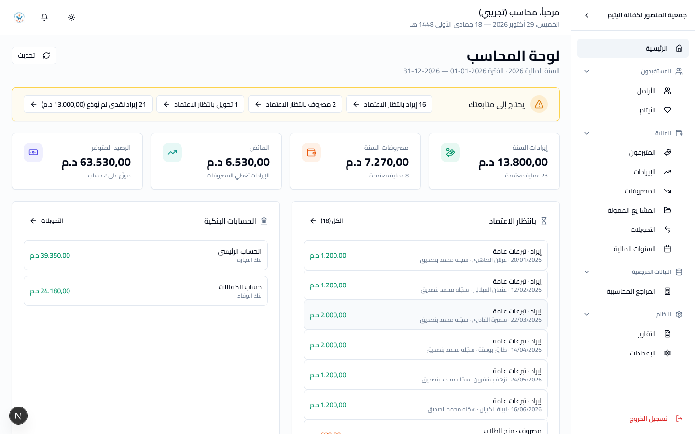
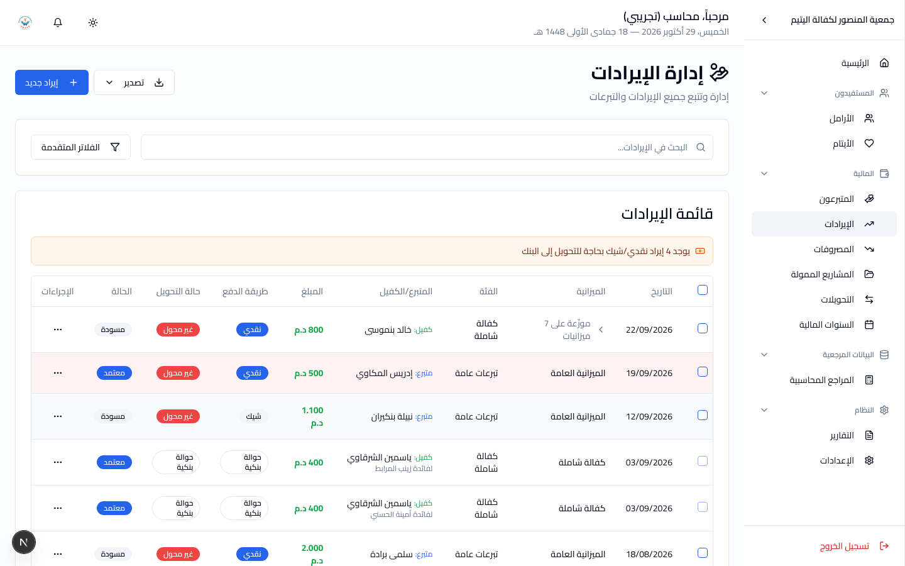

# دليل المحاسب

**دورك:** محاسب. **تملك:** دفاتر الجمعية كاملةً.

اقرأ [البداية](getting-started.md) أولاً إن لم تفعل.

---

## 1. ما تملكه

| | |
|---|---|
| الإيرادات | تسجيلها، تعديلها، **اعتمادها** |
| المصروفات | تسجيلها، تعديلها، **اعتمادها** |
| التحويلات بين الحسابات | إنشاؤها واعتمادها |
| الحسابات البنكية | إضافتها وتعديلها وحذفها |
| السنوات المالية | تهيئتها للإقفال (الإقفال نفسه للإدارة) |
| المتبرعون والكفلاء | تسجيلهم وربط الكفالات |
| تسجيل دفعات الكفالة الشاملة | وتقسيمها على الأوجه السبعة |
| المراجع المحاسبية | الفئات، الميزانيات، الشركاء |

**وحدك ومعك الإدارة من يعتمد مالاً.** الأخصائي الاجتماعي يسجّل مصروفاً،
لكن تحويله إلى مال تَحسِبه الدفاتر عملك أنت.

---

## 2. لوحتك



حين تدخل النظام تفتح على **لوحة المحاسب**:

| | |
|---|---|
| **يحتاج إلى متابعتك** | الإيرادات والمصروفات والتحويلات بانتظار الاعتماد، والإيرادات النقدية والشيكات المعتمدة التي لم تُودَع بعد في البنك |
| **الأرقام** | إيرادات السنة، مصروفاتها، الفائض، الرصيد المتوفّر |
| **بانتظار الاعتماد** | المسودات **الأقدم أوّلاً**، مع من سجّلها — المسودة التي انتظرت ثلاثة أسابيع هي التي سيُسأل عنها |
| **الحسابات البنكية** | رصيد كلّ حساب |
| **الحركة الشهرية وأبواب الصرف** | الإيرادات والمصروفات المعتمدة شهراً بشهر، وأكبر خمسة أبواب صرف |
| **إجراءات سريعة** | إيراد جديد، مصروف جديد، تحويل، متبرع أو كفيل جديد، التقرير المالي |

**زرّ "إيراد بانتظار الاعتماد" يفتح قائمة الإيرادات وقد صُفّيت على
المسودات**، و"إيراد جديد" يفتح الاستمارة مباشرةً.

**لماذا تُنبَّه إلى الإيرادات غير المودَعة طوال السنة؟** لأنّ السنة لا
تُقفل ما دامت هناك واحدة منها. أن تراها في ديسمبر متأخّر.

## 3. شاشاتك

لاحظ أنّ **قسم التعليم لا يظهر لك**. هذا مقصود.

| الشاشة | المسار |
|---|---|
| الإيرادات | المالية ← الإيرادات |
| المصروفات | المالية ← المصروفات |
| التحويلات | المالية ← التحويلات |
| المشاريع الممولة | المالية ← المشاريع الممولة |
| السنوات المالية | المالية ← السنوات المالية |
| المتبرعون والكفلاء | المالية ← المتبرعون |
| المراجع المحاسبية | البيانات المرجعية ← المراجع المحاسبية |
| التقارير | النظام ← التقارير |

---

## 4. مسودة ومعتمد



كلّ إيراد وكلّ مصروف يولد **مسودة**. المسودة مكتوبة لكنها لا تدخل
الحساب بعد.

```
تسجيل  →  مسودة  →  اعتماد  →  معتمد
```

- **المسودة** تُعدَّل وتُحذف بحرّية.
- **المعتمد** يدخل الأرصدة والتقارير.
- لإصلاح معتمد: **إرجاع إلى مسودة**، ثم التعديل، ثم الاعتماد من جديد.

**لا تعتمد ما لم تَرَ وثيقته.** الاعتماد هو اللحظة التي يصير فيها الرقم
مال الجمعية، وما بعده يترك أثراً في الأرصدة والتقارير.

قبل اعتماد مصروف تأكّد أن **الحساب البنكي محدَّد**. المصروف بلا حساب
لا يُخصم من شيء.

---

## 5. توزيع المصروف على المستفيدين

مصروف يخصّ أسراً يُوزَّع عليها بمبالغ.

**مجموع التوزيع يجب أن يساوي مبلغ المصروف تماماً.** ليس تقريباً. النظام
يرفض الحفظ إن اختلّ الفرق ولو بسنتيم.

تستطيع التوزيع على **مجموعة مستفيدين** بدل تعدادهم واحداً واحداً. المجموعات
يبنيها الأخصائي الاجتماعي.

---

## 6. الكفالة الشاملة

دفعة الكفالة الشاملة **ليست تبرّعاً واحداً**. النظام يقسمها على سبعة
أوجه، ويكتب لكلّ وجه إيراداً مستقلاً في ميزانيته المقفلة:

| الوجه | النسبة الافتراضية |
|---|---|
| تسيير | 10٪ |
| مؤونة | 50٪ |
| تعليم | 20٪ |
| صحة | 4٪ |
| تربية وترفيه | 5٪ |
| مشاريع | 6٪ |
| تكوين | 5٪ |

سبعة سطور في القائمة لدفعة واحدة — هذا طبيعي، ويجمعها النظام معاً.

**النسب نفسها تعدّلها الإدارة لا أنت** — فهي تحدّد أين يستقرّ مال
الكفالة كلّه. أنت تسجّل الدفعات وفق النسب القائمة.

ومتى عُدِّلت، **فالتعديل لا يمسّ ما سُجّل من قبل.** النسب تُقرأ لحظة
التسجيل فقط، فدفعات الأمس تبقى كما قُسّمت.

---

## 7. تهيئة السنة المالية للإقفال

**أخطر عملية في النظام.** ترحّل الأرصدة وتغلق سنةً كاملة من السجلات.

**أنت تهيّئ، والإدارة تُقفل.** زرّ الإقفال مقتصر على **مدير النظام**
و**مستخدم أعلى**. عملك هو أن تصل السنة إلى الإقفال نظيفة:

1. **لا تترك مسودة.** راجع الإيرادات والمصروفات والتحويلات: كلّ ما
   يخصّ السنة إمّا معتمد وإمّا محذوف.
2. **راجع الإيرادات غير المحوَّلة** إلى الحسابات البنكية. النظام يعرضها لك.
3. **طابق الأرصدة** مع كشوف البنك.

ثمّ أبلغ الإدارة أنّ السنة جاهزة. وإن شككت، أجّل: سنة تُقفل متأخرة أهون
من سنة تُقفل خطأً.

---

## 8. الحسابات البنكية

لكلّ حساب رصيد ودفتر حركات. كلّ اعتماد وكلّ تحويل يكتب سطراً فيه، ويحمل
السطر الرصيد بعده — فتستطيع تتبّع أيّ رقم إلى مصدره ومطابقته بكشف البنك.

**الرصيد لا يُكتب باليد.** يتحرّك باعتماد الإيرادات والمصروفات والتحويلات.
إن وجدته مخالفاً لكشف البنك، فالسبب سطر ناقص أو زائد، لا رقم خاطئ — ابحث
في الدفتر، لا في خانة الرصيد.

---

## 9. ما لا تستطيع فعله

| | لماذا | من يفعله |
|---|---|---|
| **إقفال** السنة المالية | عملية إدارية لا محاسبية | مدير النظام |
| تعديل نسب الكفالة الشاملة | تحدّد وجهة مال الكفالة كلّه | مدير النظام |
| تعديل ملف أسرة أو يتيم | ليس عملك | الأخصائي الاجتماعي |
| تسجيل التلاميذ ونقطهم | ليس عملك | مسؤول التعليم |
| إنشاء حساب مستخدم | — | مستخدم أعلى |
| قراءة سجل النشاط | — | مستخدم أعلى |

تستطيع **قراءة** كلّ ملفات الأسر والأيتام. هذا مقصود: لا يُفهم مصروف
دون معرفة من صُرف عليه.

**استثناء:** تستطيع إقفال شهر النقل المدرسي — لأنّ مصروفه مصروفك.

---

## 10. أخطاء شائعة

| | |
|---|---|
| **اعتماد قبل الوثيقة** | الاعتماد يحرّك رصيداً. انتظر الوصل. |
| **توزيع لا يساوي المبلغ** | النظام يرفض. راجع السنتيمات. |
| **مصروف بلا حساب بنكي** | لن يُخصم من شيء عند الاعتماد. |
| **تسليم سنة للإقفال وفيها مسودات** | راجعها كلّها أولاً. |
| **توقّع أن تعديل نسب الكفالة الشاملة يصحّح الماضي** | لا يصحّحه، ولا تملك تعديلها أصلاً. |

---

[← عودة إلى فهرس الأدلة](README.md)
