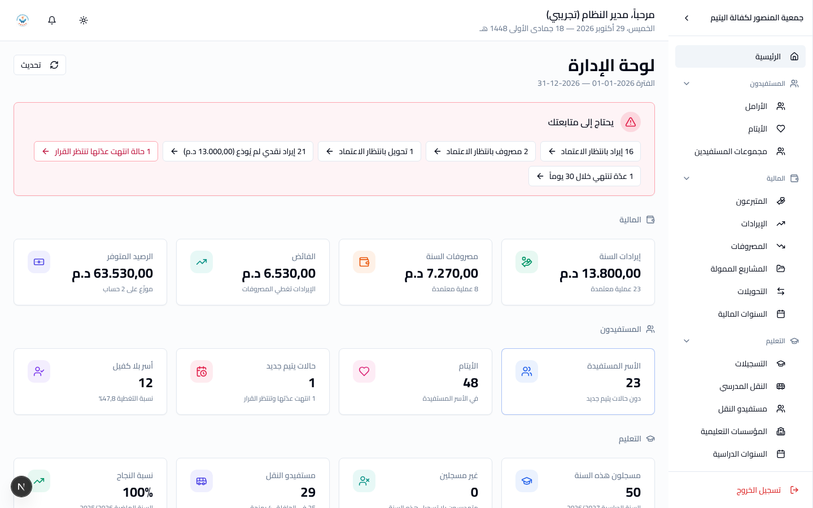

# دليل مدير النظام

**دورك:** مدير النظام. **تملك:** كلّ شيء في عمل الجمعية.

اقرأ [البداية](getting-started.md) أولاً إن لم تفعل.

---

## 1. ما تملكه

كلّ ما يملكه **المحاسب** و**الأخصائي الاجتماعي** و**مسؤول التعليم**
مجتمعين، وزيادةً:

| | |
|---|---|
| إعدادات الجمعية | الاسم والعنوان والهاتف والشعار — ما يظهر في رأس كلّ تقرير |
| **إقفال السنة المالية** | وحدك ومستخدم أعلى |
| **قواعد الكفالة الشاملة** | تعديل النسب السبع — وحدك ومستخدم أعلى |

**لا تملك** شيئين: إنشاء الحسابات، وقراءة سجل النشاط. هما لـ**مستخدم
أعلى** وحده، عن قصد: أحدهما يوزّع صلاحيات الجميع، والآخر هو سجلّ ما
فعله الجميع — وقيمته تقلّ إن استطاع من يراقبهم السجلّ أن يقرأه.

---

## 2. لوحتك

**لوحة الإدارة** ترى الجمعية كلّها من فوق، لا قسماً واحداً منها:

| | |
|---|---|
| **يحتاج إلى متابعتك** | كلّ ما ينتظر **عند الجميع** دفعةً واحدة: مسودات المحاسب، عدّة انتهت ولم يُقرَّر فيها، أشهر نقل لم تُرحَّل. إليك يُرفع المتأخّر |
| **صفّ لكلّ قسم** | المالية، المستفيدون، التعليم — أرقام كلّ قسم في صفّ واحد، لا لوحته كاملة |
| **الحركة وأبواب الصرف** | الإيرادات والمصروفات شهراً بشهر |
| **بانتظار الاعتماد / أسر تحتاج كفالة** | قائمتا العمل الأهمّ عند المحاسب والأخصائي الاجتماعي |
| **إجراءات سريعة** | مدخل إلى كلّ قسم، وإعدادات الجمعية |

## 3. لماذا يوجد هذا الدور

الجمعية صغيرة، وفيها أمسيات يكون فيها شخص واحد في المكتب. نموذج
صلاحيات يمنع المدير من تصحيح خطأ مطبعي في التاسعة ليلاً هو نموذج
يُعطَّل بعد أسبوع.

فإن كان أحدهم يقوم بأكثر من عمل واحد من أعمال الجمعية، **اجعل دوره
`مدير النظام`**. هذا هو الجواب الصحيح في جمعية بهذا الحجم، لا التفاف
على النموذج.

---

## 4. الأعمال التي تخصّك وحدك

### إقفال السنة المالية

**أخطر عملية في النظام.** ترحّل الأرصدة وتغلق سنةً كاملة من السجلات.

العمل مشترك: **المحاسب يهيّئ، وأنت تُقفل.**

قبل الإقفال تأكّد من المحاسب أنّ:

1. **لا مسودة بقيت** — كلّ إيراد ومصروف وتحويل إمّا معتمد وإمّا محذوف.
2. **الإيرادات حُوِّلت** إلى الحسابات البنكية. النظام يعرض غير المحوَّل.
3. **الأرصدة طوبقت** مع كشوف البنك.

وإن شككت، أجّل: سنة تُقفل متأخرة أهون من سنة تُقفل خطأً.

### نسب الكفالة الشاملة

دفعة الكفالة الشاملة تُقسَّم على سبعة أوجه: تسيير 10٪، مؤونة 50٪،
تعليم 20٪، صحة 4٪، تربية وترفيه 5٪، مشاريع 6٪، تكوين 5٪.

**تعديلها لا يمسّ ما سُجّل من قبل.** النسب تُقرأ لحظة التسجيل فقط.

لا تعدّلها دون قرار من الجمعية: هي تحدّد أين يستقرّ مال الكفالة.

### إعدادات الجمعية

**الإعدادات ← معلومات الجمعية.** الاسم والعنوان والهاتف والشعار تظهر في
رأس كلّ تقرير وبطاقة تطبعها الجمعية. راجعها مرّة واحدة في البداية.

---

## 5. ما ينبغي أن تتركه لأصحابه

تستطيع فعل كلّ شيء — وهذا لا يعني أن تفعله.

| | اتركه لـ |
|---|---|
| إدخال ملفّات الأسر | الأخصائي الاجتماعي |
| تسجيل الإيرادات واعتمادها | المحاسب |
| التسجيلات والنقط والنقل | مسؤول التعليم |

كلّ تعديل مكتوب في سجل النشاط باسمك. حين يُضطرّ شخص واحد إلى عمل الجميع
لا يعود السجلّ يجيب عن شيء.

---

## 6. حين يُمنع أحدهم خطأً

يشتكي موظّف أنّ زرّاً اختفى أو أنّ الحفظ يُرفض؟ غالباً دوره لا يناسب عمله.

الحلّ: اطلب من **مستخدم أعلى** تغيير دوره من **إدارة الحسابات**. لا
يضيع شيء ولا تُمسّ أيّ بيانات.

جدول "من يملك ماذا" كاملاً في [`../ROLES.md`](../ROLES.md).

---

[← عودة إلى فهرس الأدلة](README.md)
