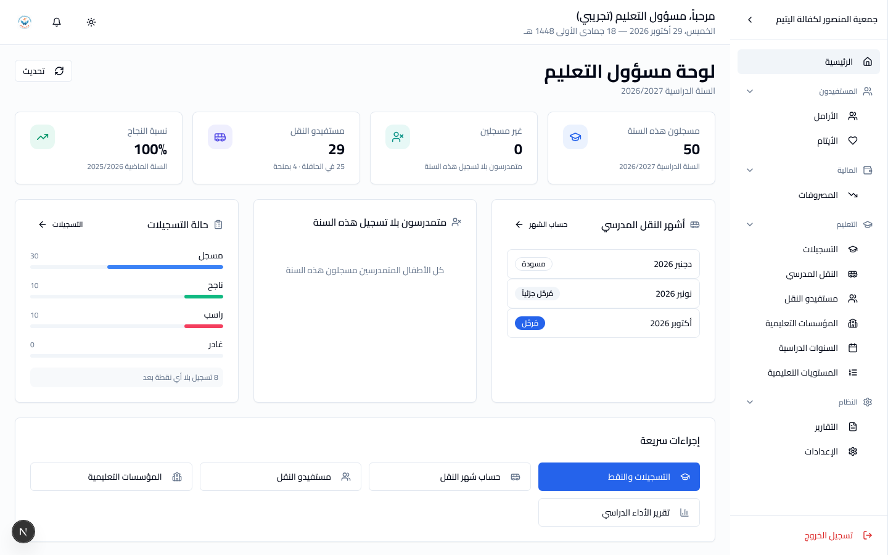
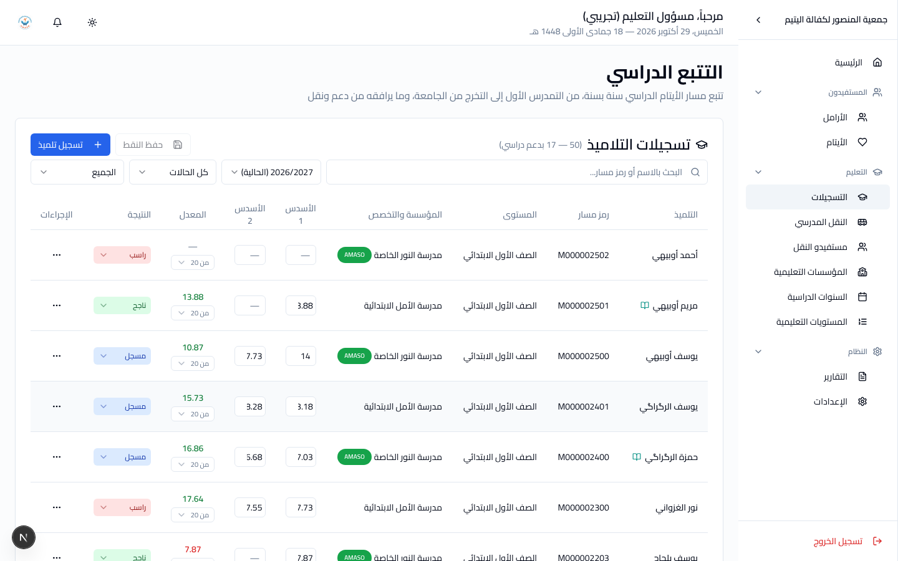
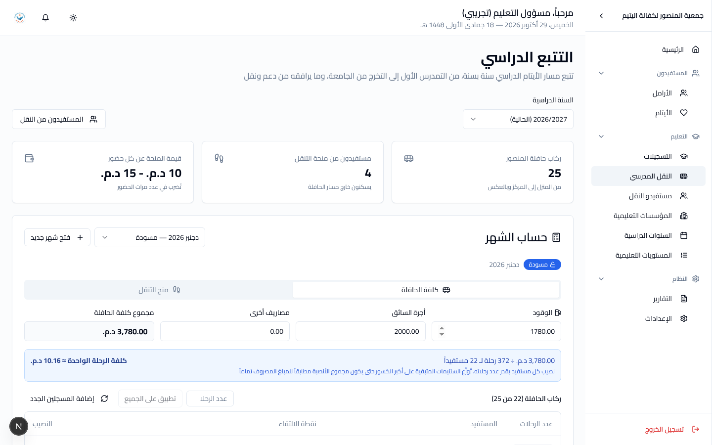

# دليل مسؤول التعليم

**دورك:** مسؤول التعليم. **تملك:** تمدرس الأيتام ونقلهم.

اقرأ [البداية](getting-started.md) أولاً إن لم تفعل.

هذا الدور جديد. قبله كان التعليم والنقل مفتوحين لكلّ من له حساب، ولم تكن
هناك طريقة لتسليم أحدهم سجلّ المدرسة دون تسليمه حسابات الجمعية البنكية
معه.

---

## 1. ما تملكه

| | |
|---|---|
| التسجيلات | تسجيل كلّ يتيم في سنته ومستواه ومؤسسته |
| النقط | نقط الأسدسين، وحساب نتيجة السنة |
| المؤسسات التعليمية | المدارس والجامعات |
| السنوات الدراسية | فتح السنة، والترحيل إليها |
| المستويات التعليمية | وطريقة احتساب النقطة في كلّ مستوى |
| النقل المدرسي | المستفيدون، وحساب كلّ شهر، وترحيله |
| المصروفات | **تسجيلها** — مصروف النقل الشهري خاصّةً — لا اعتمادها |

---

## 2. لوحتك



حين تدخل النظام تفتح على **لوحة مسؤول التعليم**، لا على لوحة عامّة:

| | |
|---|---|
| **يحتاج إلى متابعتك** | يظهر فقط حين يوجد ما يستدعيه: شهر نقل انتهى ولم يُرحَّل (بالأحمر)، شهر النقل الحالي لم يُفتح، أطفال متمدرسون بلا تسجيل هذه السنة |
| **الأرقام** | المسجلون هذه السنة، غير المسجلين، مستفيدو النقل، نسبة النجاح في السنة الماضية |
| **أشهر النقل** | كلّ أشهر السنة بحالتها: مسودة، مُرحَّل جزئياً، مُرحَّل |
| **بلا تسجيل** | أسماء الأطفال الذين ينقصهم تسجيل هذه السنة، وأسرهم |
| **حالة التسجيلات** | مسجل، ناجح، راسب، غادر — وعدد التسجيلات التي لا نقطة فيها بعد |
| **إجراءات سريعة** | التسجيلات والنقط، حساب شهر النقل، مستفيدو النقل، المؤسسات، تقرير الأداء الدراسي |

كلّ رقم وكلّ سطر يُفتح بنقرة على الشاشة التي جاء منها.

## 3. شاشاتك

في قسم **المالية** لا يظهر لك إلّا **المصروفات** — لتسجيل مصروف النقل
الشهري. الباقي (الإيرادات، التحويلات، السنوات المالية) ليس من عملك، وهذا
مقصود وليس عطلاً.

| الشاشة | المسار |
|---|---|
| التسجيلات | التعليم ← التسجيلات |
| النقل المدرسي | التعليم ← النقل المدرسي |
| مستفيدو النقل | التعليم ← مستفيدو النقل |
| المؤسسات التعليمية | التعليم ← المؤسسات التعليمية |
| السنوات الدراسية | التعليم ← السنوات الدراسية |
| المستويات التعليمية | التعليم ← المستويات التعليمية |

تلاحظ أنّ **لوحة التحكم تعرض أرقاماً مالية**. هذا طبيعي: الاطّلاع مفتوح
للجميع، والممنوع هو التعديل.

---

## 4. التسجيلات



**تسجيل واحد لكلّ يتيم في كلّ سنة دراسية.** التسجيل يحمل: السنة،
المستوى، المؤسسة، والتخصّص إن وُجد.

للتعليم العالي يُضاف **الطور وسنته**:

| الطور | المدّة |
|---|---|
| أقسام تحضيرية | سنتان |
| تقني متخصص | سنتان |
| إجازة | ثلاث سنوات |
| ماستر | سنتان |
| دكتوراه | ثلاث سنوات |
| تكوين آخر | سنتان |

حالة التسجيل: **مسجل**، **ناجح**، **راسب**، **غادر**.

### النقط

كلّ مستوى يحمل **طريقة احتساب** خاصّة به. الافتراضي أسدسان بوزن 50٪
لكلّ واحد، ونتيجة السنة مجموعهما الموزون.

**الأوزان تُنسخ على التسجيل لحظة إدخال النقطة.** إن غيّرت أوزان مستوى
لاحقاً، لن تتغيّر نتائج السنوات الماضية — وهذا مقصود: سنة انتهت لا
يُعاد حسابها.

### الترحيل إلى سنة جديدة

**السنوات الدراسية ← فتح سنة جديدة.** الترحيل ينقل كلّ تلميذ مستمرّ إلى
السنة الجديدة دفعةً واحدة بدل تسجيلهم واحداً واحداً.

افعلها **مرّة واحدة** في بداية الموسم، وراجع النتيجة قبل أن تبدأ الإدخال.

---

## 5. النقل المدرسي



### نوعان من الدعم

| | |
|---|---|
| **حافلة المنصور** | الطفل يركب، والجمعية تتحمّل كلفة التشغيل |
| **منحة تنقل** | مبلغ نقدي **عن كلّ حضور** — لا شهرياً |

الثاني يخصّ من يسكن خارج مسار الحافلة.

**حالة المستفيد:** جارٍ، موقوف مؤقتاً، منتهٍ.

**الدعم معلّق بالتسجيل لا بالطفل.** إن غيّر الطفل مؤسسته في منتصف
السنة، فله تسجيل جديد ودعم نقل جديد.

### حساب الشهر

الشهر **نصفان يُرحَّلان كلٌّ على حدة**:

| النصف | ما يُحسب |
|---|---|
| **كلفة الحافلة** | الوقود + أجرة السائق + مصاريف أخرى، تُقسَّم على ركّاب الشهر **بحسب عدد حضور كلّ واحد** |
| **منح التنقل** | قيمة المنحة × عدد الحضور، لكلّ مستفيد على حدة |

في الأولى **مبلغ واحد يُوزَّع**؛ في الثانية **كلّ سطر مستقلّ**. من لم
يحضر ولو مرّة في الحافلة نصيبه صفر — لأنّه لم يركبها.

السنتيمات المتبقّية من القسمة تُوزَّع على أكبر الكسور، حتّى يكون مجموع
الأنصبة مطابقاً للمبلغ المصروف **تماماً**.

### خطوات الشهر

```
فتح شهر جديد
      ↓
إدخال الوقود وأجرة السائق والمصاريف الأخرى
      ↓
إدخال عدد الحضور لكلّ مستفيد
      ↓
حفظ الشهر          ← الحالة: مسودة
      ↓
إنشاء مصروف كلفة الحافلة  /  إنشاء مصروف منح التنقل
      ↓
المحاسب يعتمد المصروف     ← هنا فقط يصير مالاً
```

**حالة الشهر:**

| | |
|---|---|
| **مسودة** | لم يُرحَّل أيّ نصف. الأرقام ما تزال تقديرية. |
| **مُرحَّل جزئياً** | نصف رُحِّل والآخر لا. |
| **مُرحَّل** | النصفان معاً. المبالغ مجمّدة. |

أخطأت بعد الترحيل؟ **إرجاع إلى مسودة**، ثمّ صحّح، ثمّ رحّل من جديد.

**انتبه:** ترحيل الشهر يُنشئ المصروف ويربطه، لكنّه **لا يعتمده**. المال
لا يخرج من حسابات الجمعية حتّى يعتمده المحاسب. أنت تحسب، وهو يصرف.

---

## 6. ما لا تستطيع فعله

| | لماذا | من يفعله |
|---|---|---|
| **اعتماد** مصروف | النقل يُحسب عندك ويُصرف عند الدفاتر | المحاسب |
| تسجيل إيراد أو تحويل | — | المحاسب |
| تعديل ملف أرملة أو يتيم | — | الأخصائي الاجتماعي |
| إنشاء مجموعة مستفيدين | — | الأخصائي الاجتماعي |
| تعديل المراجع العامة أو المحاسبية | — | الأخصائي الاجتماعي / المحاسب |
| إنشاء حساب مستخدم | — | مستخدم أعلى |

تستطيع **ترحيل شهر النقل** وتسجيل مصروفه، لأنّه حسابك. ما لا تستطيعه هو
**اعتماد** ذلك المصروف: يبقى مسودة لا تحرّك رصيداً حتّى يعتمده المحاسب.

تستطيع **قراءة** كلّ شيء، بما فيه المالية وملفّات الأسر.

---

## 7. أخطاء شائعة

| | |
|---|---|
| **توقّع أنّ منحة التنقل شهرية** | ليست شهرية. تُضرب في عدد الحضور. |
| **ترك خانة الحضور فارغة** | نصيبه صفر. فارغ ليس كـ"حضر دائماً". |
| **نسيان ترحيل أحد النصفين** | يبقى الشهر "مُرحَّل جزئياً". راجع النصفين. |
| **توقّع أنّ ترحيل الشهر يصرف المال** | لا يصرفه. ينتظر اعتماد المحاسب. |
| **تكرار الترحيل إلى سنة جديدة** | مرّة واحدة في بداية الموسم. |
| **تغيير أوزان مستوى لتصحيح نقطة سابقة** | لا يصحّحها. الأوزان منسوخة على التسجيل. |

---

[← عودة إلى فهرس الأدلة](README.md)
