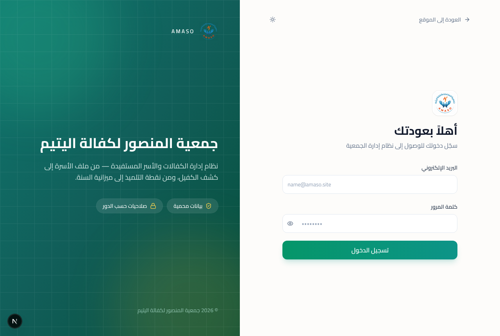

# البداية — للجميع

هذه الصفحة تخصّ كل من له حساب، مهما كان دوره.

---

## 1. الدخول إلى النظام

الدخول من خطوتين:

1. أدخل بريدك الإلكتروني وكلمة السر.
2. يصلك **رمز من ستة أرقام** على بريدك، من `system@amaso.site`. أدخله.

أشياء يجب معرفتها عن الرمز:

- **صالح عشر دقائق فقط.** بعدها لن يُقبل، ويجب طلب رمز جديد.
- **لك خمس محاولات.** بعد الخامسة يبطل الرمز كلّه، لا المحاولة وحدها،
  وتبدأ من جديد.
- **زر إعادة الإرسال يشتغل بعد 45 ثانية.** إن لم تصلك الرسالة، انتظرها
  أولاً: التأخير دقيقة أو دقيقتان أمر عادي.
- إن أخطأت رقماً، صحّحه وأعد المحاولة. **لن تخرجك الصفحة إلى البداية** —
  الرمز ما يزال قائماً حتى تنفد محاولاتك الخمس.

لم تصلك الرسالة أصلاً؟ تحقّق من مجلد الرسائل غير المرغوب فيها، ثم اتصل
بمن يملك حساب **مستخدم أعلى**. هو وحده من يستطيع إيقاف التحقق بخطوتين
على حسابك مؤقتاً حتى يُصلح البريد.

---

## 2. كلمة السر تنتهي كل 30 يوماً

قبل خمسة أيام من انتهائها يبدأ النظام بتنبيهك عند الدخول. تجاهُل التنبيه
لا يؤجّل شيئاً.

عند انتهائها، **لا يفتح لك النظام أيّ شاشة** حتى تغيّرها. هذا مقصود:
ليست هناك قائمة استثناءات تُنسى.

نفس الشيء يحدث إن أعاد **مستخدم أعلى** ضبط كلمة سرّك: تدخل، فيُطلب منك
تغييرها فوراً.

**اختر كلمة سر لا تستعملها في مكان آخر.** في هذا النظام أسماء أرامل
وأيتام حقيقيين وأرقام بطاقاتهم الوطنية.

---

## 3. القائمة الجانبية

على اليمين. الأقسام تُطوى وتُفتح، والنظام يتذكّر ما تركته مفتوحاً.

**ما تراه في القائمة هو ما تستطيع تغييره.** إن لم تجد قسماً، فهو ليس
من عملك — وليس عطلاً. مثلاً لا يرى المحاسب قسم **التعليم**، ولا يرى
مسؤول التعليم قسم **المالية**.

ملاحظة مهمة: **المنع في هذا النظام على التعديل لا على الاطّلاع.** كلّ
من له حساب يستطيع قراءة كلّ شيء تقريباً: ملفات الأسر، الأيتام، الأرقام.
ما يختلف بين الأدوار هو من يملك حقّ **الكتابة والتعديل**.

---

## 4. حسابك أنت

من **الإعدادات** تستطيع تغيير اسمك وهاتفك وكلمة سرّك. أمّا بريدك
الإلكتروني ودورك فيغيّرهما **مستخدم أعلى** وحده.

---

## 5. كلّ ما تفعله مسجَّل

كلّ إضافة وتعديل وحذف يُكتب في **سجل النشاط** باسمك وساعته. السجل
للقراءة فقط: لا أحد — ولا حتى **مستخدم أعلى** — يستطيع تعديله أو مسح
سطر منه.

هذا ليس للمراقبة بقدر ما هو حماية: إن تغيّر رقم ولم يعرف أحد لماذا،
السجل هو ما يجيب.

---

## 6. التواريخ والأرقام

- التواريخ ميلادية، والشهور بأسمائها المغربية: يناير، فبراير، مارس،
  أبريل، **ماي**، يونيو، **يوليوز**، **غشت**، **شتنبر**، أكتوبر،
  **نونبر**، **دجنبر**.
- المبالغ بالدرهم، بفاصلة عشرية من رقمين.
- في خانات البحث المنسدلة: اكتب للتصفية. إن لم يستجب المربّع، تأكّد أن
  القائمة مفتوحة أولاً.

---

[← عودة إلى فهرس الأدلة](README.md)
