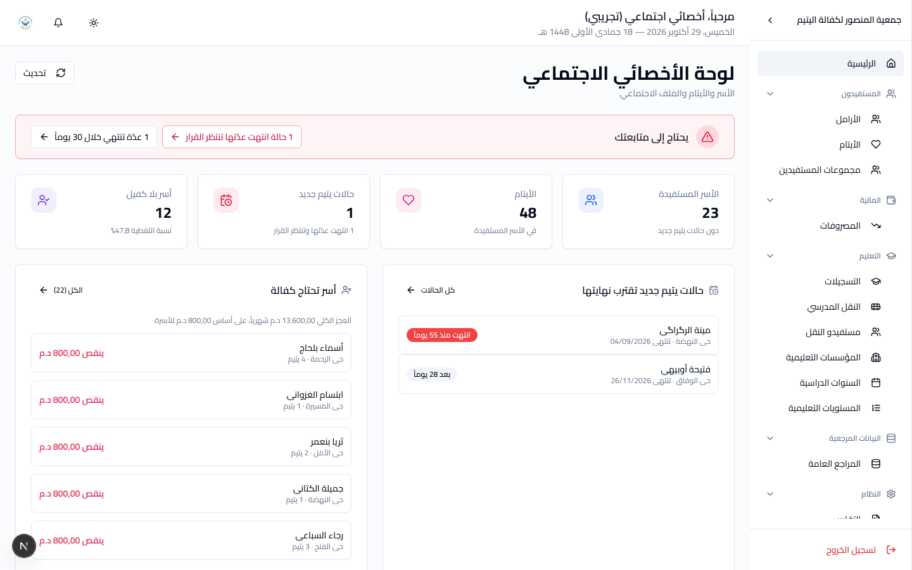
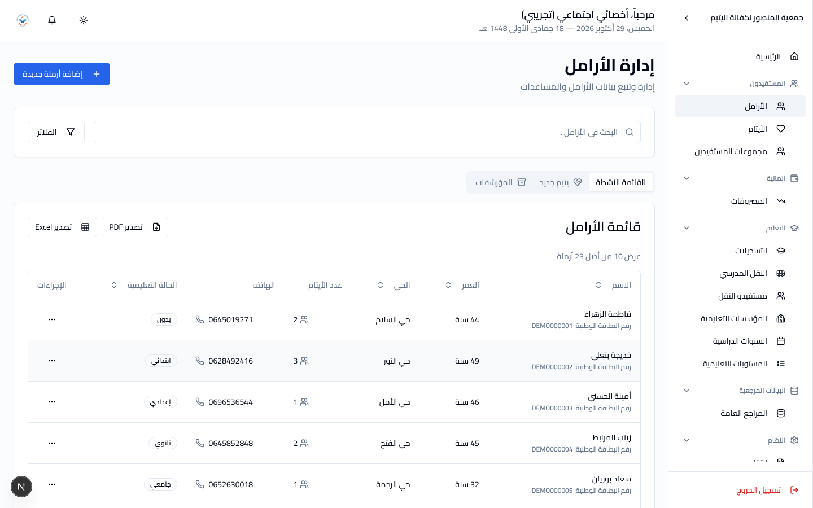

# دليل الأخصائي الاجتماعي

**دورك:** أخصائي اجتماعي. **تملك:** الأسر والأيتام وملفّهم الاجتماعي.

اقرأ [البداية](getting-started.md) أولاً إن لم تفعل.

---

## 1. ما تملكه

| | |
|---|---|
| الأرامل | تسجيلهنّ، تعديل ملفّاتهنّ، أرشفتها |
| الأيتام | تسجيلهم وتعديلهم داخل ملفّ الأسرة |
| الملف الاجتماعي | السكن، المداخيل، المصاريف، المهارات، الأمراض، المساعدات، المؤونة |
| حالات يتيم جديد | متابعتها حتى نهاية العدّة، ثمّ ضمّ الأسرة |
| مجموعات المستفيدين | إنشاؤها وإدارتها |
| المصروفات | **تسجيلها** — لا اعتمادها |
| التعليم والنقل | تسجيل التلاميذ ونقطهم ونقلهم |
| المراجع العامة | الأحياء، القطاعات، المهارات، الأمراض، أنواع المساعدات، أنواع السكن |

---

## 2. لوحتك



حين تدخل النظام تفتح على **لوحة الأخصائي الاجتماعي**:

| | |
|---|---|
| **يحتاج إلى متابعتك** | حالة انتهت عدّتها وتنتظر القرار (**بالأحمر** — متأخّرة)، وعدّة تنتهي خلال 30 يوماً |
| **الأرقام** | الأسر المستفيدة، الأيتام، حالات يتيم جديد، الأسر بلا كفيل ونسبة التغطية |
| **حالات يتيم جديد تقترب نهايتها** | كلّ عدّة انتهت أو ستنتهي خلال شهر، مع عدد الأيام |
| **أسر تحتاج كفالة** | الأسر الأشدّ نقصاً أوّلاً، وكم ينقص كلّاً منها شهرياً |
| **مصروفاتي بانتظار الاعتماد** | ما سجّلتَه **أنت** ولم يعتمده المحاسب بعد |
| **آخر الأسر المنضمّة** | أحدث خمس أسر |
| **التمدرس** | صفّ مختصر: المسجلون، غير المسجلين، النقل، نسبة النجاح |
| **إجراءات سريعة** | أسرة جديدة، تسجيل مصروف لأسرة، مجموعات المستفيدين، حالات يتيم جديد |

زرّ **أسرة جديدة** يفتح استمارة الإضافة مباشرةً، لا قائمة الأرامل فقط.

## 3. شاشاتك

| الشاشة | المسار |
|---|---|
| الأرامل | المستفيدون ← الأرامل |
| الأيتام | المستفيدون ← الأيتام |
| مجموعات المستفيدين | المستفيدون ← مجموعات المستفيدين |
| المصروفات | المالية ← المصروفات |
| التعليم كلّه | التعليم ← (كلّ الصفحات) |
| المراجع العامة | البيانات المرجعية ← المراجع العامة |
| التقارير | النظام ← التقارير |

---

## 4. الأسرة هي وحدة العمل



في هذا النظام **الأرملة هي رأس الأسرة**، وكلّ شيء آخر معلّق بها: الأيتام،
الكفالة، التمدرس، النقل، وأغلب المصاريف.

لذلك: **لا يُسجَّل يتيم وحده.** تفتح ملفّ أمّه ثمّ تضيفه داخله. شاشة
**الأيتام** للاطّلاع والبحث، لا لإنشاء يتيم بلا أسرة.

---

## 5. حالات يتيم جديد (العدّة)

الأرملة في **العدّة** — أربعة أشهر وعشرة أيّام بعد وفاة الزوج — تُعان
خلالها، **لكنّها ليست بعدُ من أسر الجمعية**.

هذا ليس تفصيلاً شكلياً: **لا تُحتسب في العدد.** لو احتُسبت لتضخّم كلّ رقم
تُصرّح به الجمعية.

```
وفاة الزوج  →  حالة يتيم جديد  →  انتهاء العدّة  →  قرار  →  أسرة من أسر الجمعية
```

عند انتهاء العدّة تعرضها لوحة **حالات يتيم جديد** في انتظار القرار. إن
قرّرت الجمعية ضمّها، تضمّها من هناك فتصير أسرةً كاملة وتدخل الأعداد.

### قاعدة لا يقبل النظام غيرها

**تاريخ الانضمام لا يسبق تاريخ وفاة الزوج أبداً.** الحالة مؤرَّخة من
الوفاة، فلا معنى لانضمام قبلها. سيرفض النظام الحفظ، وليس ذلك عطلاً.

وفي حالة يتيم جديد، **تاريخ وفاة الزوج إجباري** — لأنّ العدّة تُحسب منه.

---

## 6. الملف الاجتماعي

تحت ملفّ كلّ أرملة:

| | |
|---|---|
| **السكن** | نوعه، الماء، الكهرباء، الأثاث |
| **المداخيل** | مصادر دخل الأسرة ومبالغها |
| **المصاريف** | الإيجار، الطعام، الدواء، الفواتير… |
| **المهارات** | خياطة، طبخ، تنظيف، تدريس… |
| **الأمراض** | مع تمييز المزمن منها |
| **المساعدات** | أنواع ما تتلقّاه |
| **المؤونة** | ما يقدّمه الشركاء بانتظام |

المداخيل والمصاريف هنا **وصف لحال الأسرة**، لا محاسبةُ الجمعية. لا تدخل
دفاتر الجمعية ولا تظهر في تقاريرها المالية. مكانها هنا لأنّها ما يُبنى
عليه قرار الكفالة.

---

## 7. المصروفات: تسجّل ولا تعتمد

أنت من وزّع المساعدة، فأنت من يكتب أنّها خرجت. لكنّ تحويلها إلى مال
تَحسِبه الدفاتر عمل **المحاسب**.

```
تسجّل المصروف  →  مسودة  →  المحاسب يعتمده  →  معتمد
```

ما دام **مسودة** تستطيع تعديله وحذفه. بعد الاعتماد لا تستطيع — اطلب من
المحاسب **إرجاعه إلى مسودة**.

**مجموع التوزيع على المستفيدين يجب أن يساوي المبلغ تماماً**، وإلّا رُفض
الحفظ. إن كان المصروف يخصّ أسراً كثيرة، استعمل **مجموعة مستفيدين** بدل
إضافتهم واحداً واحداً.

---

## 8. الأرشفة لا الحذف

أسرة غادرت الجمعية **تُؤرشَف**، ولا تُحذف. تختفي من القوائم والأعداد،
ويبقى تاريخها كلّه سليماً: ما صُرف عليها، وكفالاتها، وتمدرس أبنائها.

الملفات المؤرشفة في تبويب **الملفات المؤرشفة**، ويمكن إرجاعها.

سجّل **تاريخ المغادرة وسببها**. بعد سنتين لن يتذكّر أحد.

---

## 9. التعليم والنقل

التعليم من عملك أيضاً، **إلى أن تعيّن الجمعية مسؤول تعليم**. حينها يصير
شاشاته له، وتبقى أنت قادراً على استعمالها.

وهذا يشمل **ترحيل شهر النقل** وتسجيل مصروفه — يبقى المصروف مسودة حتّى
يعتمده المحاسب.

التفاصيل في [دليل مسؤول التعليم](education-officer.md) — القسمان 4 و5.

---

## 10. ما لا تستطيع فعله

| | لماذا | من يفعله |
|---|---|---|
| **اعتماد** مصروف | الاعتماد تصرّف في مال | المحاسب |
| تسجيل إيراد | عمل الدفاتر | المحاسب |
| تحويل بين الحسابات | عمل الدفاتر | المحاسب |
| إقفال السنة المالية | — | المحاسب أو الإدارة |
| تسجيل متبرع أو كفيل، وربط كفالة | جهة التمويل | المحاسب |
| إنشاء حساب مستخدم | — | مستخدم أعلى |

تستطيع **قراءة** كلّ شيء في المالية. الممنوع هو التعديل.

---

## 11. أخطاء شائعة

| | |
|---|---|
| **محاولة تسجيل يتيم من شاشة الأيتام** | اليتيم يُضاف داخل ملفّ أمّه. |
| **تاريخ انضمام قبل وفاة الزوج** | مرفوض دائماً. راجع التاريخين. |
| **نسيان ضمّ الأسرة بعد انتهاء العدّة** | تبقى خارج الأعداد. راجع لوحة حالات يتيم جديد. |
| **حذف أسرة غادرت** | أرشفها. الحذف يفقد تاريخها. |
| **توزيع مصروف لا يساوي مبلغه** | مرفوض. راجع السنتيمات. |
| **انتظار ظهور مصروف في التقارير** | لا يظهر قبل اعتماد المحاسب له. |

---

[← عودة إلى فهرس الأدلة](README.md)
