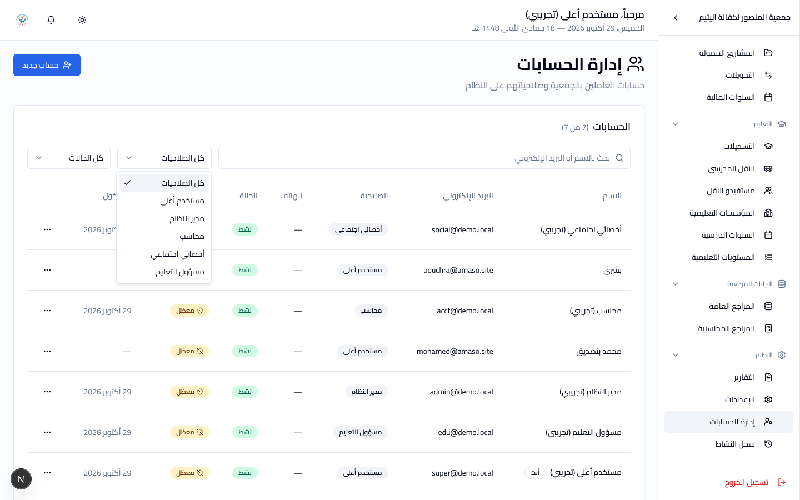

# دليل المستخدم الأعلى

**دورك:** مستخدم أعلى. **تملك:** كلّ شيء، ومعه الحسابات وسجل النشاط.

اقرأ [البداية](getting-started.md) أولاً إن لم تفعل.

---

## 1. ما يميّزك عن مدير النظام

شيئان فقط، وهما الشيئان اللذان لا يملكهما أحد غيرك:

| | |
|---|---|
| **إدارة الحسابات** | إنشاء الحسابات، تغيير الأدوار، التفعيل والتعطيل، إعادة ضبط كلمات السر |
| **سجل النشاط** | قراءة ما فعله كلّ مستخدم |

السبب: أحدهما يوزّع صلاحيات الجميع، والآخر هو سجلّ ما فعله الجميع.
وسجلٌّ يستطيع من يراقبهم أن يقرأه ويسترشد به يفقد معناه.

**اجعل عدد أصحاب هذا الدور قليلاً** — اثنان يكفيان، وواحد خطر: إن ضاع
حسابه لم يبقَ من يُنشئ الحسابات.

---

## 2. إدارة الحسابات



**النظام ← إدارة الحسابات.**

### إنشاء حساب

تحتاج: الاسم، البريد الإلكتروني، الدور، وكلمة سرّ أولى.

**البريد الإلكتروني يجب أن يكون حقيقياً ويصل صاحبه.** إليه يُرسَل رمز
التحقق في كلّ دخول. بريد خاطئ = حساب لا يستطيع صاحبه الدخول إليه أبداً.

كلمة السرّ الأولى مؤقّتة: يُطلب من صاحبها تغييرها عند أوّل دخول.

### اختيار الدور

| الدور | لمن |
|---|---|
| **مستخدم أعلى** | من يدير النظام نفسه. اثنان على الأكثر. |
| **مدير النظام** | مدير الجمعية، أو من يقوم بأكثر من عمل |
| **محاسب** | من يمسك الدفاتر |
| **أخصائي اجتماعي** | من يتابع الأسر |
| **مسؤول التعليم** | من يتابع التمدرس والنقل |

**من يقوم بأكثر من عمل واحد، دوره `مدير النظام`.** في جمعية بهذا الحجم
هذا جواب صحيح لا التفاف على النموذج.

الجدول الكامل في [`../ROLES.md`](../ROLES.md).

### التعطيل بدل الحذف

غادر موظّف؟ **عطّل حسابه، ولا تحذفه.** الحساب المعطّل لا يدخل، ويبقى
اسمه مقروناً بكلّ ما فعله في السجل والسجلّات.

---

## 3. التحقّق بخطوتين، وحين يتعطّل البريد

كلّ حساب يدخل برمز يصله على بريده. **إن توقّف البريد، لم يعد أحد يدخل** —
ولا أنت.

لذلك وحدك تستطيع **إيقاف التحقّق بخطوتين** على حساب بعينه، من إدارة
الحسابات.

هذا **باب الطوارئ**، لا إعداد دائم:

1. أوقفه على حساب واحد فقط، وللمدّة اللازمة.
2. أصلح البريد.
3. **أعِد تشغيله فوراً.**

حساب بلا تحقّق بخطوتين محميّ بكلمة سرّ وحدها، في نظام فيه أسماء أرامل
وأيتام حقيقيين وأرقام بطاقاتهم الوطنية.

وللطوارئ القصوى، من الخادم:

```bash
php artisan amaso:mail-test you@example.com    # هل البريد يعمل أصلاً؟
php artisan amaso:two-factor                   # الحسابات وحالتها
php artisan amaso:two-factor --all --off       # إيقاف عامّ - آخر حلّ
```

---

## 4. سجل النشاط

**النظام ← سجل النشاط.**

كلّ إضافة وتعديل وحذف، باسم صاحبها وساعتها وعنوان شبكته وما تغيّر.

**للقراءة فقط.** لا يوجد في النظام أيّ طريق لتعديل سطر أو حذفه — ولا
لك. هذا ما يجعله يستحقّ الثقة.

يبقى السطر بعد حذف الحساب: الاسم مكتوب فيه نصّاً، لا بالإحالة وحدها.

استعمله حين يتغيّر رقم ولا يعرف أحد لماذا. ابحث بالمستخدم أو بنوع
السجلّ أو بالتاريخ.

---

## 5. كلمات السرّ

تنتهي كلّ 30 يوماً. تغيير المدّة من الخادم:

```bash
php artisan amaso:password-policy --days=60
php artisan amaso:password-policy --code-minutes=15   # مدّة صلاحية الرمز
```

نسي أحدهم كلمة سرّه؟ أعِد ضبطها من إدارة الحسابات؛ يُطلب منه تغييرها
عند أوّل دخول.

---

## 6. عند تشغيل نموذج الأدوار الجديد

قبل هذا التحديث كانت الأدوار موجودة بالاسم أكثر منها بالأثر: خارج إدارة
الحسابات وسجل النشاط واعتماد الإيرادات والمصروفات والحسابات البنكية
وإعدادات الجمعية، كان كلّ حساب يستطيع كلّ شيء تقريباً.

الآن صارت الأدوار تعني شيئاً. لذلك **راجع دور كلّ حساب** من إدارة
الحسابات قبل أن يبدأ الناس عملهم:

- من يقوم بأكثر من عمل → **مدير النظام**.
- من دوره `أخصائي اجتماعي` وهو يمسك الدفاتر → **محاسب** أو **مدير النظام**.
- لا أحد يحمل دور **مسؤول التعليم** بعد. امنحه لمن يتابع التمدرس، إن كان
  غير الأخصائي الاجتماعي.

مُنع أحدهم خطأً؟ غيّر دوره. لا يضيع شيء ولا تُمسّ أيّ بيانات.

---

[← عودة إلى فهرس الأدلة](README.md)
